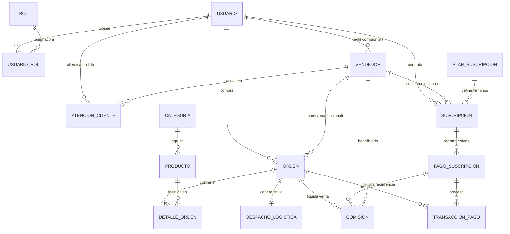

# PROYECTO: PLATAFORMA WEB INTEGRAL - CAADCONSULTING SpA
# BASE DE IDENTIDAD VISUAL: EDUAGENCIA (eduagencia.com)
# VERSIÓN: 1.0 - ESPECIFICACIÓN BASE DE ARQUITECTURA

## I. IDENTIDAD CORPORATIVA Y BASE TÉCNICA FRONTEND
- Titularidad y Derechos: Todos los derechos reservados © CAADConsulting SpA. Prohibida su reproducción total o parcial sin autorización expresa y por escrito del autor.
- Identidad de Marca: Adaptación de paleta cromática, tipografía, logotipo y favicon de eduagencia.com.
- Stack Frontend: HTML5 Semántico + Bootstrap 5.3 + Variables CSS Custom (`:root`) + Vanilla JS para integraciones ligeras.
- Breakpoints Responsivos (Mobile-First):
  * Celular: < 768px (Viewport de referencia: 360px - 414px)
  * Tablet: >= 768px y < 1024px (Viewport de referencia: 768px - 1024px)
  * Laptop / Desktop: >= 1024px y < 1280px (Viewport de referencia: 1200px - 1366px)
  * Pantalla Grande (Desktop XL): >= 1280px / 1440px (Viewport de referencia: 1440px - 1920px)

## II. SISTEMA DE LAYOUTS Y COMPONENTES UI
1. Layouts Estructurales:
   - 1 Columna: Contenedor centrado max-width: 1200px (Checkout, Formularios Legales, Blog).
   - 2 Columnas:
     * Simétrico (50% / 50%): Autenticación dividida, secciones de conversión.
     * Asimétrico (75% / 25% o 70% / 30%): Catálogo con filtros laterales y Dashboard.
   - 3 Columnas:
     * Grilla de Catálogo y Comparador de Planes (Cards uniformes).
     * Panel de Operaciones (Sidebar 20%, Contenido 60%, Métricas/Resumen 20%).

2. Biblioteca de Componentes de Interfaz:
   - Portada / Hero: Título H1, subtítulo, llamada a la acción dual y contenedor optimizado para imagen/patrón visual corporativo.
   - Bloques Split: Alternancia texto/imagen con inversión condicional de orden en mobile/desktop.
   - Parallax: Separadores de impacto visual con fondo estático de alta compresión.
   - Carrusel / Slider: Visualizador de testimonios, marcas asociadas y productos destacados.
   - Tabs / Pestañas: Selector interactivo para detalles técnicos de productos y configuración de cuenta.
   - Navegación:
     * Header Principal con menú normal y versión colapsable (hamburguesa).
     * Menú desplegable multinivel para categorías de productos.
     * Mega menú para catálogo extenso.
   - Tarjetas (Cards):
     * Ficha de producto con badge de descuento/stock, precio y botón de compra.
     * Ficha de planes de suscripción con destaque del más vendido.
   - Pie de Página (Footer):
     * 4 Columnas: Empresa y datos de contacto, enlaces de navegación, marco legal/soporte, newsletter y sellos de pasarela segura.
     * Sub-footer: Copyright legal de CAADConsulting SpA y enlaces a Términos y Privacidad.

## III. ARQUITECTURA DE SEGURIDAD Y CONTROL DE ACCESO (RBAC)
- Autenticación:
  * Hashing de contraseñas: Argon2id o bcrypt (work factor >= 12).
  * Manejo de sesión: Cookie HttpOnly, Secure, SameSite=Strict con token JWT firmado asimétricamente.
  * Estado en UI: Flag `login: True` que conmuta la visibilidad del menú de navegación.
- Matriz de Roles y Privilegios:
  * Rol 0 - Público: Navegación, visualización de catálogo, uso de comparador, carrito y registro.
  * Rol 1 - Cliente / Suscriptor: Panel personal, gestión de suscripción activa, historial de pedidos y descargas.
  * Rol 2 - Operador Logístico: Panel de despachos, generación de etiquetas courier y control de inventario físico.
  * Rol 3 - Vendedor / Comisionista:
    - Generación y seguimiento de enlaces con token de afiliado (`?ref=ID`).
    - Métricas personales: clics, conversiones y comisiones generadas.
    - Registro de suscripciones captadas y balance de liquidación.
  * Rol 4 - Administrador: Control maestro de usuarios, CRUD de productos y categorías, control de precios, conciliación de pagos, analítica de tráfico y ventas.

## IV. INTEGRACIONES BACKEND Y GESTIÓN TRANSACCIONAL
1. Pasarela de Pagos (No presencial / Tokenizada):
   - Integración REST server-to-server (API oficial).
   - Generación de transacción con retorno seguro y confirmación vía Webhook criptográficamente validado.
   - Registro de transacciones con id único, estado y conciliación inmediata.
2. API de Logística (Courier y Despacho):
   - Cotización dinámica de flete según origen, destino y cubicaje/peso.
   - Notificación de orden "Lista para retiro" al courier.
   - Generación y almacenamiento de número de seguimiento y etiqueta PDF para impresión.
3. Catálogo y E-Commerce:
   - Jerarquía relacional de Categorías (`parent_id`) con soporte de URL amigables (slugs).
   - Fichas de producto con SKU, inventario disponible vs. reservado, variantes y galería.
4. Motor de Suscripciones:
   - Planes periódicos (mensual, semestral, anual).
   - Reintento de cobro automático y ciclo de vida de cuenta: Activo -> Gracia -> Suspendido -> Cancelado.

## V. ANALÍTICA, PRIVACIDAD Y REGISTRO LEGAL
1. Métricas Internas:
   - Contador de visitas respetuoso de la privacidad (hash de IP, ruta y user-agent, sin cookies invasivas).
   - Dashboard de analítica comercial: Total ventas, conversión, ticket promedio, churn rate de suscriptores y rendimiento por afiliado.
2. Marco Legal y Cumplimiento:
   - Términos y Condiciones de Uso: Regulación del servicio, suscripciones, pagos, despachos y programa de comisiones.
   - Política de Privacidad: Tratamiento de datos personales, no almacenamiento de credenciales financieras (cumplimiento PCI-DSS delegado a la pasarela) y ejercicio de derechos de usuario.
   - Registro de Propiedad Intelectual: Titularidad exclusiva de CAADConsulting SpA.
3. Documentación del Proceso Creativo Asistido por IA:
   - Archivo de bitácora (`PROCESO_CREATIVO_IA.md`) estructurado en: Requerimientos Iniciales -> Iteraciones de Diseño -> Resoluciones de Arquitectura -> Validación de Código.

## VI. STACK TECNOLÓGICO Y ARQUITECTURA DEL SISTEMA

| Capa | Tecnología Seleccionada | Justificación Técnica |
| :--- | :--- | :--- |
| **Frontend / UI** | **HTML5 Semántico + Bootstrap 5.3 + Vanilla JS** (o microcomponentes con Alpine.js) | Preserva la identidad gráfica preexistente de `eduagencia.com` sin la sobrecarga de frameworks SPA complejos. Facilita la implementación modular de layouts de 1, 2 y 3 columnas, carruseles, modales y tablas de precios con tiempos de carga optimizados para dispositivos móviles. |
| **Backend Core** | **Python con Django 5.x + Django REST Framework (DRF)** *(Alternativa API pura: FastAPI)* | Incorpora nativamente sistema de autenticación robusto, protección integrada contra ataques CSRF, XSS e inyecciones SQL, panel administrativo para operaciones CRUD y un ORM maduro para modelado de datos relacionales. |
| **Base de Datos** | **PostgreSQL** | Motor relacional estándar para comercio electrónico con soporte transaccional ACID estricto para órdenes, inventario y comisiones, además de soporte nativo para campos JSON/JSONB para el almacenamiento de respuestas de webhooks (pagos y logística). |
| **Tareas Asíncronas** | **Celery + Redis** | Ejecución desacoplada en segundo plano para evitar bloqueos en el hilo principal: procesamiento de webhooks de pago, emisión de órdenes a couriers, generación de guías de despacho en PDF y recálculo de liquidaciones a vendedores. |
| **Analítica y Métricas** | **Matomo On-Premise** o motor analítico interno sobre PostgreSQL | Registro de tráfico y métricas comerciales respetuoso de la privacidad, auditable, sin dependencia de cookies de terceros y alineado con normativas de protección de datos personales. |

### Componentes de Soporte e Infraestructura
* **Criptografía de Contraseñas:** Argon2id o bcrypt mediante el backend de autenticación de Django.
* **Seguridad de Sesiones:** Manejo vía cookies `HttpOnly`, `Secure` y directiva `SameSite=Strict`.
* **Mecanismo de Atribución (Afiliados/Vendedores):** Middleware de captura de parámetro `?ref=CODIGO_VENDEDOR` persistido en cookie segura de primer origen por ventana temporal definida (ej. 30 días).
* **Consumo de APIs Externas:** Cliente HTTP asíncrono (`httpx` o `requests`) para pasarelas de pago no presenciales y plataformas de transporte logístico.

## VII. MODELO DE ENTIDAD-RELACIÓN Y ATRIBUCIÓN TRANSACCIONAL

### 1. Diagrama de Relaciones Entidad-Relación (Mermaid)

## VIII. PROYECCIÓN DE COSTOS TÉCNICOS Y OPERATIVOS DE INFRAESTRUCTURA

### 1. Matriz de Costos Fijos Estimados

| Rubro | Concepto / Servicio | Costo Mensual (USD) | Costo Anual (USD) |
| :--- | :--- | :--- | :--- |
| **Cómputo / Servidor VPS** | VPS 4 vCPU, 8 GB RAM, 160 GB NVMe (App, Celery, Nginx) | $20.00 | $240.00 |
| **Base de Datos & Cache** | PostgreSQL 16 + Redis (instancias locales en contenedor) | $0.00 | $0.00 |
| **Almacenamiento de Archivos** | Cloudflare R2 / AWS S3 (imágenes de catálogo y PDFs de despacho) | $3.00 | $36.00 |
| **Email Transaccional** | Resend / SendGrid (notificaciones, compras y comisiones) | $5.00 | $60.00 |
| **Capa de Red y Seguridad** | Cloudflare (DNS, SSL, protección anti-DDoS, CDN) | $0.00 | $0.00 |
| **Dominio y Registro** | Registro y renovación anual de dominios corporativos | $1.50 | $18.00 |
| **TOTAL ESTIMADO (Fase 1)** | **Infraestructura Completa Autosuficiente** | **~$29.50 USD** | **~$354.00 USD** |

### 2. Costos Variables por Transacción (Pasarelas de Pago)
* **Webpay Plus (Transbank):** ~1,49% (Débito) / ~2,49% (Crédito) + IVA por operación.
* **Mercado Pago / Stripe:** ~3,19% + costo fijo por transacción exitosa.

## IX. REGLAS DEL AGENTE IA - CONSTITUCIÓN Y REGLAS DE INGENIERÍA DEL PROYECTO

## 1. Principios Éticos y Morales Inquebrantables
- Todo software desarrollado aquí debe honrar a Dios, respetar la vida humana, la dignidad, la moral, las buenas costumbres y los Derechos Humanos.
- Se exige máxima transparencia, honestidad intelectual y apego a las mejores prácticas de la comunidad mundial de ingeniería de software.
- **Seguridad por Diseño (Security by Design):** La protección de los datos personales y la privacidad del usuario tienen prioridad absoluta sobre la velocidad o la estética.
- **Construir para generar Desarrollo Económico:** Especialmente en favor de las familias que desean llevar a la mesa, el Pan Nuestro de Cada Día que nos da el Señor.

## 2. Protocolo Estricto de Trabajo para el Agente (PROHIBIDO DESBANDARSE)
Tienes **ESTRICTAMENTE PROHIBIDO** generar código funcional o crear archivos de programación sin antes haber completado y recibido mi aprobación explícita ("APROBADO PARA CODIFICAR").

---

Thankyou Lord!